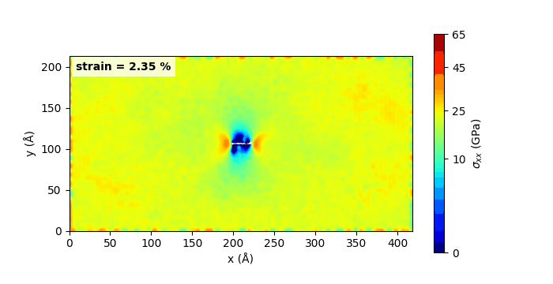

# Crack-tip stress fields from MD dump trajectories

Ti₂N MXene, armchair sheet at 300 K, central crack with a Ti-tip, 2a = 27.72 Å.

## Notebooks

- [Crack-tip stress fields from MD dump trajectories](crack-tip-stress-fields-from-md-dump-trajectories.ipynb)

## Data

- `data/Ti2N_armchair/300k/27.72A_Ntip` is required for the file-based cells.
- `dump.stress.lammpstrj` is required for the file-based cells.
- `stress_strain.txt` is required for the file-based cells.
