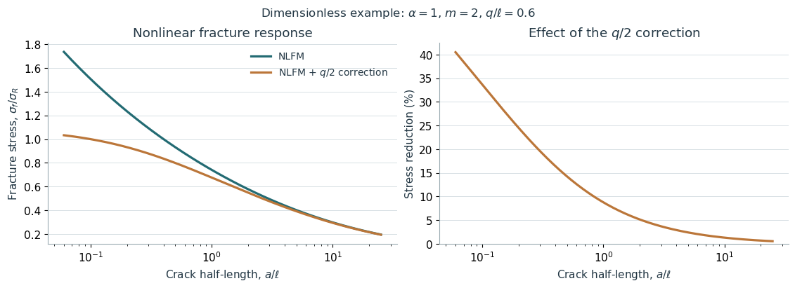

# Solving nonlinear fracture equations

NLFM calculations with a quantized-length correction, using dimensionless example parameters.

## Notebooks

- [Solving nonlinear fracture equations](solving-nonlinear-fracture-equations.ipynb)
