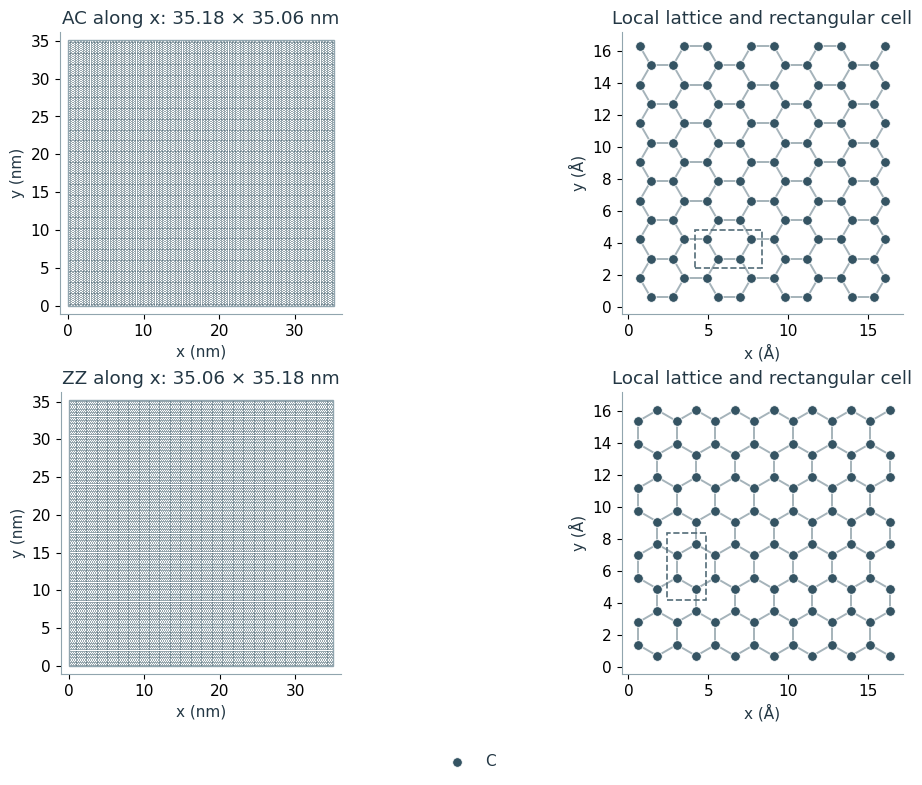

# Generating graphene monolayers

Pristine graphene sheets for molecular-dynamics models, with armchair and zigzag orientations.

## Notebooks

- [Generating graphene monolayers](generating-graphene-monolayers.ipynb)

## Generated geometry files

- [graphene_AC.data](data/graphene_AC.data)
- [graphene_ZZ.data](data/graphene_ZZ.data)
