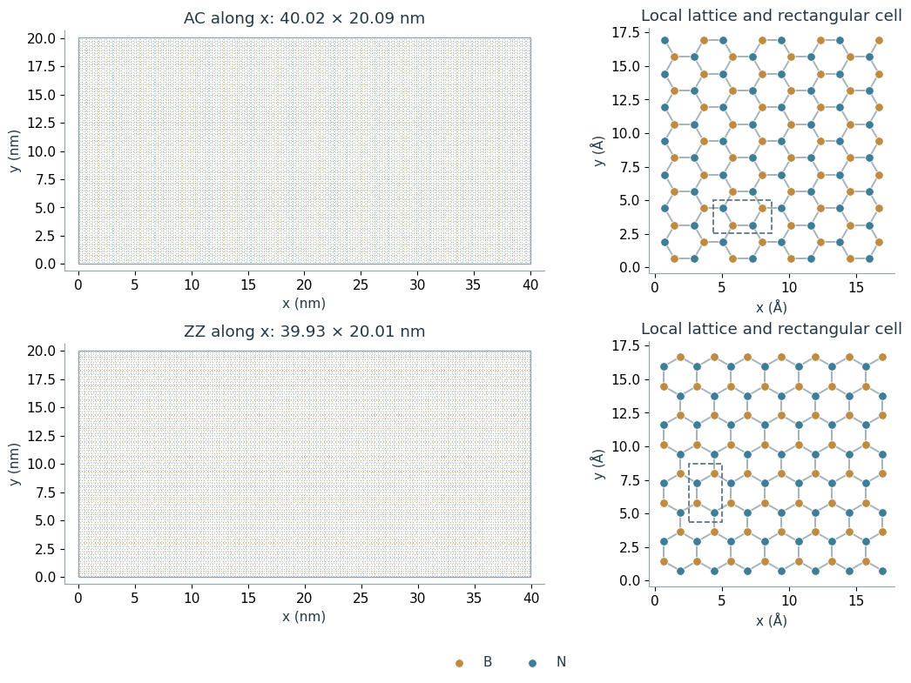

# Generating hexagonal boron nitride monolayers

The pristine hBN sheet generated here was used in the literature validation for my ongoing molecular-dynamics work.

## Notebooks

- [Generating hexagonal boron nitride monolayers](generating-hexagonal-boron-nitride-monolayers.ipynb)

## Generated geometry files

- [hbn_AC.data](data/hbn_AC.data)
- [hbn_ZZ.data](data/hbn_ZZ.data)
