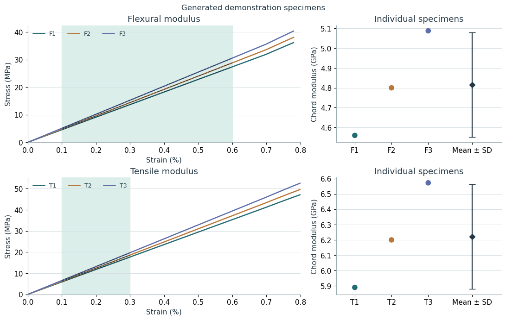

# Calculating elastic modulus

Calculation of elastic modulus for the Bouligand composite manuscript analysis. The Excel workbook here contains generated example data.

## Notebooks

- [Calculating elastic modulus](calculating-elastic-modulus.ipynb)

## Data

- `inputs/composite_example.xlsx` is included.
