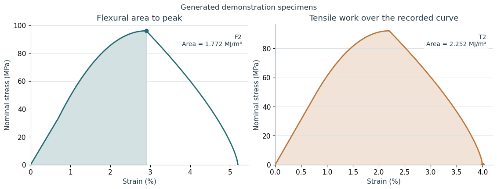

# Integrating flexural and tensile curves

Calculation of flexural and tensile curve areas for the Bouligand composite manuscript analysis. The Excel workbook here contains generated example data.

## Notebooks

- [Integrating flexural and tensile curves](integrating-flexural-and-tensile-curves.ipynb)

## Data

- `inputs/composite_example.xlsx` is included.
