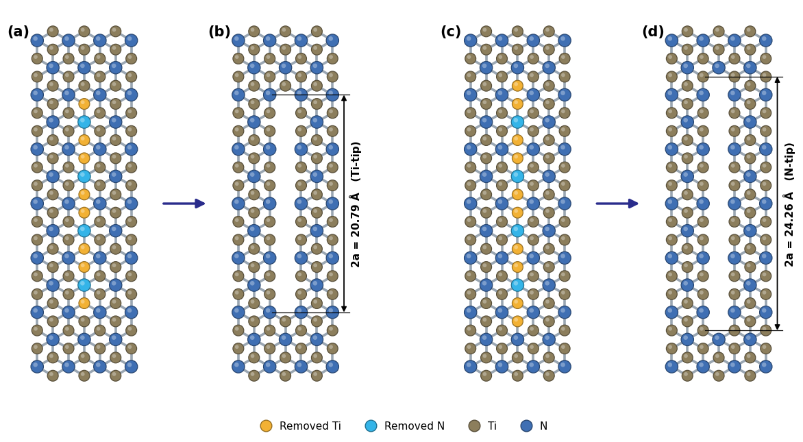

# Mechanical engineering programming

Programming work in C and Python, including NumPy, Pandas, Matplotlib, SciPy and scikit-learn. The collection includes elementary exercises, numerical methods, and calculations used during courses, experiments, thesis work and manuscript preparation.

## Research and engineering examples

- [Center-notch construction in Ti₂N](02-atomistic-geometry-and-fracture/01-center-notch-construction/README.md): Lattice-based atom selection and nominal crack length.
- [Crack-tip stress fields](02-atomistic-geometry-and-fracture/02-crack-tip-stress-fields-from-md-dump-trajectories/README.md): Per-atom LAMMPS stress processing, contours and animation.
- [Graphene monolayers](02-atomistic-geometry-and-fracture/04-generating-graphene-monolayers/README.md): Periodic sheet construction and LAMMPS data export.
- [Hexagonal boron nitride monolayers](02-atomistic-geometry-and-fracture/05-generating-hexagonal-boron-nitride-monolayers/README.md): Pristine sheets used in the literature validation for ongoing research.
- [Nonlinear fracture equations](02-atomistic-geometry-and-fracture/03-solving-nonlinear-fracture-equations/README.md): NLFM and a quantized-length correction with dimensionless example parameters.
- [Elastic modulus](05-composite-calculations/01-calculating-elastic-modulus/README.md): Composite calculations using a generated example workbook.
- [Flexural and tensile curve areas](05-composite-calculations/02-integrating-flexural-and-tensile-curves/README.md): Curve integration using a generated example workbook.

## Subjects

| Subject | Contents |
| --- | --- |
| [C programming](01-c-programming/README.md) | 96 C programs in 17 lessons |
| [Atomistic geometry and fracture](02-atomistic-geometry-and-fracture/README.md) | 5 notebooks |
| [Numerical methods](03-numerical-methods/README.md) | 29 notebooks |
| [Heat transfer and physics](04-heat-transfer-and-physics/README.md) | 13 notebooks |
| [Composite calculations](05-composite-calculations/README.md) | 2 notebooks |
| [Scientific visualization](06-scientific-visualization/README.md) | 8 notebooks |
| [Pandas and Excel](07-pandas-and-excel/README.md) | 39 notebooks |
| [Machine learning](08-machine-learning/README.md) | 51 notebooks |
| [Neural networks](09-neural-networks/README.md) | 11 notebooks |
| [Engineering calculations](10-engineering-calculations/README.md) | 4 notebooks |
| [Python foundations](11-python-foundations/README.md) | 15 notebooks |

[Complete topic list](CATALOG.md) · [Notebook index](notebooks.csv) · [Sources](SOURCES.md)

## Reading and running

Open a notebook to read the code, notes and saved outputs. The animated crack sequence is also available as a GIF in its topic folder. C examples include source files, inputs and recorded outputs.

Scientific Python dependencies are listed in `requirements.txt`. Machine-learning and neural-network dependencies are separated into `requirements-ml.txt` and `requirements-neural.txt`. The earlier local environment is recorded in `environment-reference.txt`.

Run notebook cells with the notebook's own folder as the working directory. Topic READMEs list required data files and any recorded dataset links. Raw simulation trajectories and experimental workbooks are not included. The composite examples use generated data.

The saved outputs and earlier execution checks have different verification scopes. See [VERIFICATION.md](VERIFICATION.md) for the details. Practice-table contact fields use anonymous example addresses.

## Coursework

The C examples include Computer Programming (ME 2221) and its sessional (ME 2222), taken in the second year, second semester, together with exercises from Numerical Computation for Mechanical Engineers (ME 3121) and its sessional (ME 3122).

Tutorial references are retained in the relevant folders and notebooks. Reuse terms for third-party material are described in [SOURCES.md](SOURCES.md).
